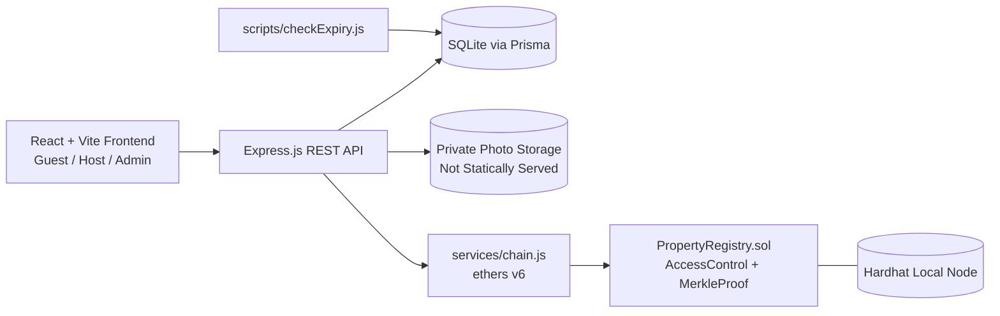

### The Clear Vision for StaySure

**One-Line Pitch:** StaySure is a **cryptographic "Freshness & Anti-Tamper Seal" for rental listings**—proving to renters that the photos they see today are the exact, unaltered photos verified on a specific date, without ever putting private photos or addresses on a public blockchain.

**Why the previous spec felt blurry:** It focused heavily on backend rules and database states, leaving the actual blockchain value invisible. A grader watching a 5-minute demo needs to *see* three concrete things happen on screen:

1. **The Problem Solved Visually (Anti-Bait-and-Switch):** A guest clicks **"Verify On-Chain"** on any listing and sees a live cryptographic audit—comparing the server's current photo files against the immutable Merkle root stored in `PropertyRegistry.sol`.
2. **The "Aha!" Tamper Moment:** You alter 1 byte of a stored photo on the server, click **"Verify On-Chain"** again, and the UI immediately flips from **Green (`MATCH`)** to **Red (`TAMPERED`)**, pinpointing the exact photo whose Merkle proof failed.
3. **Privacy-Preserving Blockchain Design:** The UI explicitly displays the **On-Chain vs. Off-Chain Split**—showing that the smart contract only holds an HMAC fingerprint, a Merkle root, a metadata hash, and a timestamp, while real addresses, GPS, and photos stay private off-chain.

---

### `ARCHITECTURE.md`

```markdown
# StaySure Architecture (v3 — React + Node.js)

**Vision:** A cryptographic, tamper-evident verification seal for property rentals.
**Stack:** React (Vite, plain JS + plain CSS), Node.js + Express.js, Prisma ORM + SQLite, Solidity `^0.8.20`, Hardhat 2, OpenZeppelin (`AccessControl`, `MerkleProof`), `ethers` v6.

This file is the single source of truth. If code and this document disagree, update both in the same change.

---

## 1. The Core Idea & Why Blockchain?

**The Real-World Problem:** Rental platforms suffer from bait-and-switch scams—hosts upload 3-year-old photos, steal photos from other listings, or silently swap photos after a listing is approved. A traditional database cannot prove to a renter that the platform or host didn't quietly alter the photos later.

**The StaySure Solution:**
1. **Live, Session-Bound Capture:** Hosts capture 3 required views (`living_room`, `bedroom`, `bathroom`) using a live browser camera (`getUserMedia`) tied to a single-use, 10-minute server nonce and GPS radius check.
2. **Duplicate & Fraud Screening:** Exact photo reuse across properties is blocked (SHA-256). Visually similar/resized reuse (pHash) or overlapping addresses (30 m proximity) are frozen in an **Admin Review Queue** before anything touches the blockchain.
3. **Merkle Seal On-Chain:** Accepted photo sets are hashed into a 3-leaf Merkle tree. Only the **HMAC property fingerprint**, **Merkle root**, **metadata hash**, and **block timestamp** are anchored in an append-only smart contract (`PropertyRegistry.sol`).
4. **One-Click Guest Audit:** Any guest can click **"Verify On-Chain"** to recompute hashes from the stored photos and verify each photo's Merkle proof directly against the smart contract.
5. **Automatic Freshness Expiry:** Verification seals expire after 30 days (`DUE_SOON` at day 25, `EXPIRED` at day 30) so stale listings never display as Verified.

**Honest Trust Boundary (Displayed in the UI):**
- **What the blockchain proves:** A specific set of photos was committed by an authorized verifier at a specific block timestamp and has not been altered since.
- **What it does NOT prove:** That the photo wasn't spoofed before upload (browser camera and GPS can be spoofed, and the backend verifier wallet is a trust point).

---

## 2. The 5-Minute Live Demo Storyboard (Design Target)

The React UI is built specifically to make these 5 moments effortless to demonstrate live:

| Demo Step | Action in React UI | What the Grader Sees |
|---|---|---|
| **1. Deduplication** | Host registers `"12 Elm St, Flat 4-B"`, then tries `"12 elm st, flat 4 b"`. | First succeeds with an on-chain `registerTx`. Second is **rejected** (identical HMAC fingerprint). |
| **2. Live Seal** | Host opens **Capture Page**, takes 3 live camera snapshots, clicks Submit. | Property flips to **VERIFIED**. UI shows `txHash`, `blockNumber`, `merkleRoot`, and **Trust Index**. |
| **3. Guest Audit (Pass)** | Guest opens listing and clicks **"Verify On-Chain"**. | **Proof Inspector** opens: Green `MATCH` banner, matching on-chain vs. recomputed roots, and 3/3 valid per-photo Merkle proofs. |
| **4. Tamper Detection (Fail)** | Modify 1 byte of `bedroom.jpg` on disk (or delete it), then click **"Verify On-Chain"**. | Red **`TAMPERED`** alert (or Amber **`EVIDENCE_INCOMPLETE`**) showing mismatched roots and the failed proof. |
| **5. Review-Before-Chain & Expiry** | Upload a resized copy of an existing photo -> flagged `UNDER_REVIEW` (no chain tx) -> Admin approves in **Admin Queue** -> confirmed on-chain. Run `npm run check-expiry` on a 31-day-old listing -> flips to `EXPIRED`. | Proves suspicious uploads never reach the chain unapproved and expired listings never show as Verified. |

---

## 3. System Context



**Architectural Rule:** Express route handlers stay thin and never import `ethers`. `backend/services/chain.js` is the **only** module that communicates with the smart contract.

---

## 4. On-Chain vs. Off-Chain Privacy Split

| Stored On-Chain (`PropertyRegistry.sol`) | Stored Off-Chain (SQLite + Private Disk) |
| --- | --- |
| HMAC-SHA256 property fingerprint (`bytes32`) | Raw photos (`backend/private_media/`) |
| Merkle root per verification (`bytes32`) | Street address, unit, building, exact GPS |
| Canonical metadata hash (`bytes32`) | User accounts, emails, bookings |
| Block timestamp (`uint256`) | Photo SHA-256 and pHash values |
| Append-only verification array | Cached `txHash` and `blockNumber` |

Never put photos, addresses, exact GPS coordinates, or PII on-chain.

---

## 5. Cryptographic Specification (Exact Byte-for-Byte Contract Agreement)

1. **Property Fingerprint:**
`fingerprint = "0x" + HMAC_SHA256(FINGERPRINT_SECRET, normalize(address) + "|" + normalize(unit) + "|" + normalize(building))`
* `normalize(s)`: lowercase, strip all characters except `a-z0-9`.
* `Flat 4-B` and `flat 4 b` produce the exact same fingerprint; any unit/building difference produces a different one.


2. **Photo Hash:** `photo_sha256 = SHA-256(raw file bytes)`.
3. **Merkle Leaf:** `leaf = keccak256(photo_sha256 as 32 raw bytes)`.
4. **Leaf Order:** Photos sorted ascending by `viewLabel` as plain strings (`bathroom`, `bedroom`, `living_room`).
5. **Internal Node:** `keccak256(min(a, b) || max(a, b))` (OpenZeppelin `MerkleProof` sorted-pair order).
6. **Odd Node Rule:** An unpaired node is promoted unchanged to the next level. `photo_count` is committed in the metadata hash to prevent second-preimage ambiguity.
7. **Metadata Hash:** `keccak256(UTF-8 bytes of canonical JSON)` with sorted keys and no whitespace:
`{"merkle_root":"0x...","nonce":"...","photo_count":3,"property_id":"...","schema_version":1,"server_timestamp":"2026-...Z","session_id":"..."}` (no coordinates).
8. **Perceptual Hash (pHash):** 64-bit grayscale perceptual hash computed with `sharp`; similarity measured by Hamming distance (`<= PHASH_THRESHOLD`, default `5`).

---

## 6. Smart Contract: `PropertyRegistry.sol`

Inherits OpenZeppelin `AccessControl` (`DEFAULT_ADMIN_ROLE`, `VERIFIER_ROLE`). Uses OpenZeppelin `MerkleProof`.

```solidity
struct Property { address host; uint256 registeredAt; uint256 lastVerifiedAt; bool active; }
struct Verification { bytes32 merkleRoot; bytes32 metadataHash; uint256 timestamp; }

```

| Function | Access & Behavior |
| --- | --- |
| `registerProperty(bytes32 fingerprint, address host)` | `VERIFIER_ROLE`; reverts `"Property already registered"` |
| `submitVerification(bytes32 fingerprint, bytes32 merkleRoot, bytes32 metadataHash)` | `VERIFIER_ROLE`; reverts `"Unknown property"` / `"Property inactive"`; appends record; updates `lastVerifiedAt` |
| `deactivateProperty(bytes32 fingerprint)` | `VERIFIER_ROLE`; reverts `"Unknown property"`; keeps history readable |
| `getStatus(bytes32 fingerprint)` | `view`; returns `(registered, active, lastVerifiedAt, count)` |
| `getVerification(bytes32 fingerprint, uint256 index)` | `view`; returns `Verification`; reverts `"Invalid verification index"` |
| `verifyPhoto(bytes32 fingerprint, uint256 index, bytes32[] proof, bytes32 leaf)` | `view`; reads stored `merkleRoot` from storage (caller never supplies root) and calls `MerkleProof.verify` |

**Events:** `PropertyRegistered(fingerprint, host)`, `PropertyVerified(fingerprint, merkleRoot, index, timestamp)`, `PropertyDeactivated(fingerprint)`.

History is strictly append-only—no function may edit or delete past records.

---

## 7. Data Model (Prisma + SQLite)

* **User:** `id` (UUID), `username` (unique), `email`, `passwordHash` (`bcryptjs`), `role` (`HOST` | `GUEST` | `ADMIN`), `walletAddress` (nullable), `identityVerified` (bool, admin-only).
* **Property:** `id` (UUID), `hostId`, `name`, `description`, `city`, `bedrooms`, `bathrooms`, `maxGuests`, `amenities` (JSON), `address` (private), `unitNumber`, `building`, `latitude`, `longitude`, `price`, `fingerprint` (unique), `status`, `lastVerifiedAt`, `registerTx`, `needsReview` (bool), `createdAt`.
* **CaptureSession:** `id` (UUID), `propertyId`, `hostId`, `nonce`, `requiredViews` (JSON), `expiresAt`, `used` (bool), `createdAt`.
* **Submission:** `id` (UUID), `propertyId`, `sessionId` (unique), `processingState`, `failureReason`, `similarFlag` (bool), `txHash` (nullable), `createdAt`.
* **Photo:** `id` (UUID), `submissionId`, `propertyId`, `viewLabel`, `filePath` (private), `sha256`, `phash`, `latitude`, `longitude`, `capturedAt` (server time only).
* **VerificationRecord:** `id`, `propertyId`, `submissionId` (unique), `recordIndex`, `merkleRoot`, `metadataHash`, `txHash`, `blockNumber`, `createdAt`. Unique `(propertyId, recordIndex)`. Never edited or deleted.
* **Booking:** `id`, `guestId`, `propertyId`, `checkIn`, `checkOut`, `totalPrice`, `status` (`CONFIRMED` | `CANCELLED`), `createdAt`.
* **Review:** `id` (UUID), `propertyId`, `guestId`, `rating` (1–5), `comment`, `createdAt`. Unique `(propertyId, guestId)`.

---

## 8. Dual Status Model & Expiry

* **Public Property Status:** `PENDING`, `VERIFIED`, `DUE_SOON`, `EXPIRED`, `UNDER_REVIEW`, `REJECTED`.
* **Internal Submission State:** `RECEIVED`, `VALIDATING`, `PENDING_REVIEW`, `APPROVED`, `CHAIN_SUBMITTED`, `CONFIRMED`, `FAILED`, `REJECTED`.

**Rules:**

* A failed blockchain transaction marks the submission `FAILED` (retryable) and **never** marks the property `VERIFIED`.
* Expiry is derived from `lastVerifiedAt` (`>= 25d` -> `DUE_SOON`, `>= 30d` -> `EXPIRED`).
* `scripts/checkExpiry.js` persists derived expiry off-chain (no blockchain tx) and **never** overwrites `UNDER_REVIEW` or `REJECTED`.

---

## 9. Verification Pipeline & Idempotent Chain Write

1. **Start Session:** `POST /api/properties/:id/capture-session` -> 10-min single-use nonce + `["living_room", "bedroom", "bathroom"]`.
2. **Live Capture:** React `CapturePage` uses `getUserMedia` (no `<input type="file">`) + Geolocation API.
3. **Strict Validation Order (`POST /api/properties/:id/upload-photo`):**
* (a) Session exists, belongs to host & property, unused, unexpired.
* (b) Nonce matches.
* (c) Exact 3 required views, valid JPEG/PNG/WEBP, under `MAX_UPLOAD_MB`.
* (d) GPS within `GPS_RADIUS_METERS` (default `100 m`).
* (e) Exact SHA-256 duplicate on another property -> **Reject (`400`)**.
* (f) pHash distance `<= PHASH_THRESHOLD` (or property `needsReview`) -> **Flag (`PENDING_REVIEW` / `UNDER_REVIEW`)**, stop before chain.


4. **Admin Review Gate:** Flagged submissions only reach the chain after an admin clicks **Approve** in the React Admin Queue.
5. **Idempotent Chain Submission:** Before sending `submitVerification`, check if `submission.txHash` already exists; if mined (`status === 1`), parse the event and save `VerificationRecord` without resending. Never create two records for one submission.

---

## 10. Trust Index (0–100)

| Factor | Max | Rule |
| --- | --- | --- |
| Latest photo verification | 30 | `VERIFIED`: 30, `DUE_SOON`: 20, else: 0 |
| Host identity verification | 25 | 25 only if `identityVerified === true` (set by Admin), else 0 |
| Duplicate checks | 20 | 20 if no unresolved review flag, else 0 |
| Verification history | 15 | 2+ records: 15, 1 record: 8, none: 0 |
| Host rating | 10 | `Math.round((averageRating / 5) * 10)` from guest reviews, else 0 |

**Discovery Sorting (`GET /api/properties?sort=...`):**
* `recommended` (default): `combinedScore = (averageRating / 5) * 100 + trustScore` descending; ties broken by `averageRating` descending (higher rating wins ties), then `ratingCount` descending.
* `most_rated`: `ratingCount` descending, then `averageRating` descending, then `trustScore` descending.

Displayed as a clear breakdown card with a disclaimer that the score is not a guarantee of physical condition.

---

## 11. REST API

| Method | Endpoint | Purpose |
| --- | --- | --- |
| `POST` | `/api/auth/register`, `/api/auth/login` | Account creation & JWT auth |
| `GET`, `POST` | `/api/properties` | Public search/list; Host registration |
| `GET` | `/api/properties/:id` | Public detail (approx. GPS, Trust Index, on-chain/off-chain summary) |
| `POST` | `/api/properties/:id/capture-session` | Start live capture session |
| `POST` | `/api/properties/:id/upload-photo` | Submit live-captured photos |
| `GET` | `/api/properties/:id/history` | Append-only on-chain verification history |
| `GET` | `/api/properties/:id/verify-onchain?index=N` | Recompute hashes + call `verifyPhoto` on-chain |
| `POST`, `GET` | `/api/bookings` | Traveler (`GUEST`) only: create booking (rejects overlapping `CONFIRMED` dates) & list own bookings |
| `PATCH` | `/api/bookings/:id/cancel` | Cancel guest's own booking |
| `POST` | `/api/properties/:id/reviews` | Traveler (`GUEST`) only: submit 1–5 star review (1 per guest per property) |
| `GET` | `/api/host/properties` | Host (`HOST`) only: list host's own properties |
| `GET` | `/api/host/bookings` | Host (`HOST`) only: list bookings on host's own properties |
| `GET` | `/api/admin/submissions` | Admin review & failed-tx retry queue |
| `GET` | `/api/admin/submissions/:id/photos/:viewLabel` | Authenticated admin photo inspection for flagged reviews |
| `POST` | `/api/admin/submissions/:id/approve` | Approve flagged submission & submit to chain |
| `POST` | `/api/admin/submissions/:id/reject` | Reject submission & property |
| `POST` | `/api/admin/submissions/:id/retry` | Idempotent retry for `FAILED` chain writes |
| `PATCH` | `/api/admin/users/:id/identity` | Admin toggle for `identityVerified` |

---

## 12. Repository Layout

```text
staysure/
  ARCHITECTURE.md
  README.md
  .gitignore
  contracts-project/
    contracts/PropertyRegistry.sol
    test/PropertyRegistry.js
    scripts/deploy.js
    hardhat.config.js
  backend/
    prisma/schema.prisma
    routes/              # auth.js, properties.js, verification.js, bookings.js, host.js, admin.js
    middleware/          # auth.js, upload.js
    services/            # hashing.js, merkle.js, chain.js, propertyService.js, verificationService.js, bookingService.js, reviewService.js
    scripts/             # checkExpiry.js, demoE2E.js, seedDemo.js
    tests/               # automated backend & integration tests
    private_media/       # gitignored, never served publicly
    contract_abi.json
    server.js
    .env.example
  frontend/
    src/
      api/client.js
      components/        # Navbar, ProtectedRoute, StatusBadge, TrustIndexCard, ProofInspector
      pages/             # Listings, PropertyDetail, MyTrips, HostDashboard, HostBookings, CapturePage, AdminQueue, Login, Register
      styles.css         # plain CSS
    index.html
  eval/
    evaluatePhash.js     # precision/recall across thresholds 3, 5, 8, 10

```

---

## 13. Configuration (`.env.example`)

`PORT=4000`, `JWT_SECRET`, `FINGERPRINT_SECRET`, `DATABASE_URL="file:./dev.db"`, `RPC_URL="http://127.0.0.1:8545"`, `CONTRACT_ADDRESS`, `BACKEND_PRIVATE_KEY`, `GPS_RADIUS_METERS=100`, `PHASH_THRESHOLD=5`, `SESSION_TTL_MINUTES=10`, `EXPIRY_DAYS=30`, `DUE_SOON_DAYS=25`, `PROXIMITY_METERS=30`, `MAX_UPLOAD_MB=10`. Never commit `.env`.

---

## 14. Testing & Evaluation

* **Smart Contract (`npx hardhat test`):** All role checks, revert strings, append-only history, `verifyPhoto` valid/invalid proofs, and gas report.
* **Backend (`npm test`):** Fingerprint normalization, session rules, GPS radius, SHA-256 & pHash duplicates, Merkle odd-leaf proofs, metadata hash determinism, idempotent retry, expiry protection, booking overlap, tamper/missing-photo detection, RBAC isolation, review creation/uniqueness, and rating + trust sorting with tie-breakers.
* **Evaluation (`node eval/evaluatePhash.js`):** 20 originals, 10 resized, 10 cropped/edited, 5 unrelated; outputs TP, FP, TN, FN, Precision, and Recall at thresholds `3, 5, 8, 10`.

```

```